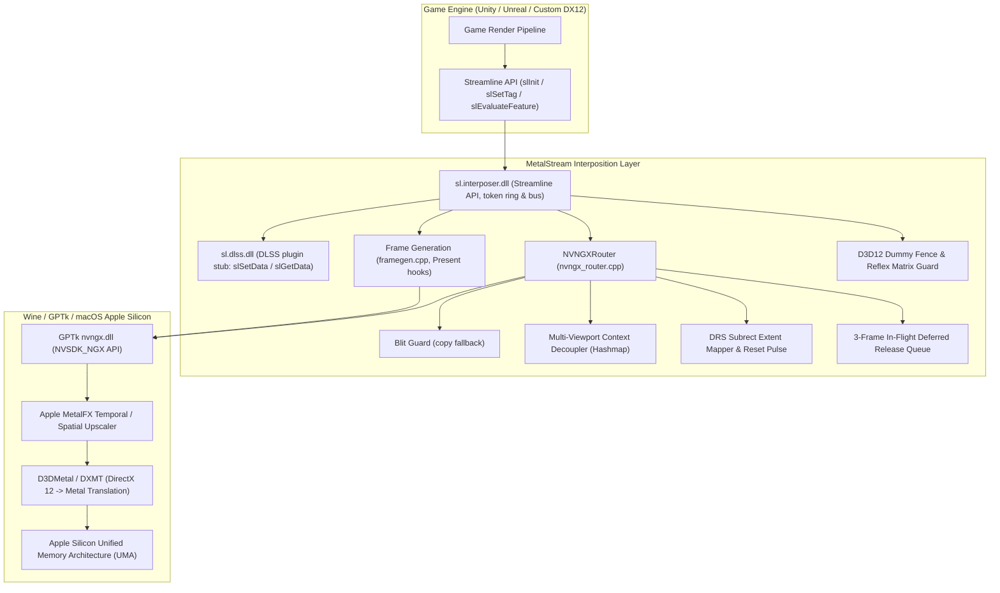

# MetalStream

**English** | [简体中文](README.zh-CN.md) | [繁體中文](README.zh-TW.md)

MetalStream replaces NVIDIA Streamline's `sl.interposer.dll` and `sl.dlss.dll` for x86_64 DirectX 12 games that run on Apple Silicon Macs through Wine, CrossOver, Game Porting Toolkit (GPTk), MacHoYo or Whisky. When a game asks Streamline for DLSS upscaling or DLSS Frame Generation, MetalStream passes the request to GPTk's `nvngx.dll`, and D3DMetal carries it out with Apple's MetalFX.

> MacHoYo, mentioned throughout this README, is a macOS solution for HoYoverse games. It is still in development and hasn't been released yet.

To use it in a game, download a release and follow [Installing a release](#installing-a-release). Building from source is only needed for development.

## Contents

- [How it fits together](#how-it-fits-together)
- [Features](#features)
- [Architecture](#architecture)
  - [Phase 1: memory safety, COM contracts and locking](#phase-1-memory-safety-com-contracts-and-locking)
  - [Phase 2: D3D12 dummy fence and Reflex matrices](#phase-2-d3d12-dummy-fence-and-reflex-matrices)
  - [Phase 3: dynamic resolution scaling (DRS) and subrects](#phase-3-dynamic-resolution-scaling-drs-and-subrects)
  - [Phase 4: multiple viewports and deferred release](#phase-4-multiple-viewports-and-deferred-release)
  - [Phase 5: resource states and the Streamline bus](#phase-5-resource-states-and-the-streamline-bus)
  - [Phase 6: end-to-end tests](#phase-6-end-to-end-tests)
- [Frame generation (DLSS-G) on Apple Silicon](#frame-generation-dlss-g-on-apple-silicon)
  - [How MetalStream generates frames (prototype)](#how-metalstream-generates-frames-prototype)
  - [The pause after toggling DLSS-G](#the-pause-after-toggling-dlss-g)
- [Installing a release](#installing-a-release)
  - [Step 1: check whether your game needs it](#step-1-check-whether-your-game-needs-it)
  - [Step 2: check what your launcher supports](#step-2-check-what-your-launcher-supports)
  - [Step 3: replace the two files](#step-3-replace-the-two-files)
  - [Step 4: turn it on](#step-4-turn-it-on)
  - [Step 5: check that it works](#step-5-check-that-it-works)
  - [Undoing it and common problems](#undoing-it-and-common-problems)
  - [Launchers and tools](#launchers-and-tools)
- [Building and testing](#building-and-testing)
  - [Prerequisites (macOS host)](#prerequisites-macos-host)
  - [Building](#building)
  - [Continuous integration and releases](#continuous-integration-and-releases)
  - [Local paths](#local-paths)
  - [Wine regression suites](#wine-regression-suites)
- [Deploying to a game](#deploying-to-a-game)
  - [Backup and deployment](#backup-and-deployment)
  - [Configuration (`metalstream.ini`)](#configuration-metalstreamini)
  - [Logs](#logs)
- [Repository layout](#repository-layout)
- [Contributors](#contributors)
- [License](#license)

## How it fits together



## Features

- Streamline interposition. MetalStream implements the Streamline lifecycle calls (`slInit`, `slShutdown`, `slSetTag`, `slSetConstants`, `slEvaluateFeature`, `slSetData`, `slGetData`) and forwards the DXGI and Direct3D 12 factory functions to the system runtimes.
- MetalFX upscaling. DLSS requests (`kFeatureDLSS`) go to MetalFX temporal upscaling through GPTk's `nvngx.dll`.
- DLSS Frame Generation. MetalStream implements the `sl.dlss_g` side of DLSS-G on top of D3DMetal's NGX `FrameGeneration` feature (`MTLFXFrameInterpolator`). See [Frame generation on Apple Silicon](#frame-generation-dlss-g-on-apple-silicon).
- No HAGS requirement. `slGetFeatureRequirements` never reports `eHardwareSchedulingRequired`, so games don't turn off DLSS or DLSS-G because Wine lacks hardware-accelerated GPU scheduling.
- Blit Guard. If MetalFX fails to create or evaluate a feature, MetalStream copies the unscaled color input into the output (`CopyResource` with `COPY_SOURCE` / `COPY_DEST` transitions, restored afterwards) so the frame doesn't come out black.
- No runtime dependencies. The DLLs link the runtime statically (`-static -static-libgcc -static-libstdc++`) and target the Universal CRT.
- MIT license. The code is a clean-room implementation and works with MacHoYo, Whisky, DXMT, YAAGL and other macOS game launchers.

## Architecture

The work happened in six phases. Each one has its own test suite (see [Wine regression suites](#wine-regression-suites)).

### Phase 1: memory safety, COM contracts and locking

- Every `IUnknown` / `ID3D12Resource` pointer passed in through tags and constants gets `AddRef()` when stored and `Release()` when dropped, so the engine can't destroy a resource MetalStream still holds.
- Frame tokens live in a fixed 6-slot ring (`frameHandles[sl::MAX_FRAMES_IN_FLIGHT]`, guarded by `mtxFrameHandle`) instead of being allocated per frame. Slots are handed out in order and wrap around, which rules out token reuse collisions and use-after-free in multithreaded render pipelines.
- Locks are taken in one order: the interposer's outer `stateMutex`, then `NVNGXRouter::m_mutex`. This prevents deadlocks when `slShutdown` or `slInit` runs while a frame is being evaluated. The frame generation code never holds its own `m_mutex` while it takes the interposer state mutex, or across a real `Present`.

### Phase 2: D3D12 dummy fence and Reflex matrices

- MetalStream creates a real D3D12 fence (`m_dummyFence`, via `ID3D12Device::CreateFence`) and reports it with its signaled value in `state.inputsProcessingCompletionFence`. Without it, an engine that calls `ID3D12CommandQueue::Wait` during DLSS Frame Generation evaluation dereferences a null pointer.
- View and projection matrices start as 4x4 identity matrices ($I_4$). An engine that reads Reflex latency constants before setting up its camera gets valid values instead of a division by zero or NaN.
- `sl.interposer.dll` exports `slReflexSetMarker` directly, alongside `slGetFeatureFunction`, for engines that call Reflex without going through the dispatch table.

### Phase 3: dynamic resolution scaling (DRS) and subrects

- MetalStream reads resolution and offset from `ResourceTag::extent` (`sl::Extent`) and walks the tag chains of all render targets (`kResourceTagColorIn`, `kResourceTagColorOut`, `kResourceTagMotionVectors`, `kResourceTagDepth`, `kResourceTagHUDLessColor`).
- The active DRS subrect goes into the NGX evaluation parameters (`DLSS_Render_Subrect_Dimensions_*`, `DLSS_Input_Color_Subrect_Base_*`, `DLSS_Input_Depth_Subrect_Base_*`, `DLSS_Input_MV_SubrectBase_*`, and `DLSS_Output_Subrect_Base_*` with `DLSS_Enable_Output_Subrects`), so MetalFX only scales the rendered part of the viewport.
- When the DRS resolution or the viewport size changes, `reset = 1` is sent for that one frame and cleared on the next. This keeps stale temporal history from smearing or ghosting.
- The NGX create flags come from the game's DLSS options and constants: `NVSDK_NGX_DLSS_Feature_Flags_IsHDR`, `MVLowRes`, `MVJittered`, `DepthInverted`, `AutoExposure`, `DoSharpening` and `AlphaUpscaling`.

### Phase 4: multiple viewports and deferred release

- Each viewport ID (for example `0` for the main camera, `1` for a mirror, `2` for a minimap) gets its own `NVSDK_NGX_Handle*` and resolution state in `m_viewportContexts`. One viewport changing resolution no longer forces the others to recreate their contexts.
- When a viewport is resized or destroyed, its old NGX handle waits in `m_deferredReleases` for 3 frames and is released only after the GPU has finished every command list that could still reference it.
- `slAllocateResources` and `slFreeResources` are implemented, so a game can create resources ahead of time and free them at a known point, independently of frame evaluation.

### Phase 5: resource states and the Streamline bus

- Upscaling leaves tagged resources in the states the game left them in (`sl::Resource::state`). MetalStream adds transitions only for resources it touches itself: the Blit Guard copy (`COPY_SOURCE` / `COPY_DEST`, restored to the engine's states afterwards) and the frame generation copies.
- Both `sl.interposer.dll` and `sl.dlss.dll` implement and export `slSetData` and `slGetData`, so plugins can pass data to each other in either direction.

### Phase 6: end-to-end tests

- `test_streamline_e2e_eval.cpp` runs under Wine + D3DMetal and covers multithreaded frame token stress, multiple viewports, DRS subrect mapping, resource barrier transitions, bus round trips and deferred release.

## Frame generation (DLSS-G) on Apple Silicon

### How MetalStream generates frames (prototype)

DLSS-G doesn't need NVIDIA's optical flow hardware here. GPTk 4.0's D3DMetal implements the NGX `FrameGeneration` feature (the `nvngx_dlssg` contract and its `DLSSG.*` parameters) on top of the public MetalFX `MTLFXFrameInterpolator` API, available on macOS 26 and later. D3DMetal turns it on only when a file named `nvngx_dlssg.dll` is in the game directory. Games with DLSS-G ship that file anyway.

MetalStream takes the place of NVIDIA's `sl.dlss_g` plugin (`src/interposer/framegen.cpp`):

1. Present interception. `slInit` patches the vtables of the system `dxgi.dll` factory, so every swapchain the game creates has its `Present`, `Present1` and `ResizeBuffers` hooked. `slUpgradeInterface` on a factory or swapchain is handled as well.
2. Interpolation. Once the game enables DLSS-G (`slDLSSGSetOptions` with `eOn` or `eAuto`), every `Present` evaluates NGX FrameGeneration with the backbuffer, the game's HUD-less color, depth and motion vector tags, and the camera data from `sl::Constants`. D3DMetal expects motion vectors in pixels of the motion vector texture, so Streamline's UV-space `mvecScale` is multiplied by the motion vector resolution. Tags marked `eOnlyValidNow` are copied when they are tagged so they're still valid at `Present`.
3. Presentation. The game renders into proxy backbuffers (through hooked `GetBuffer` and `GetCurrentBackBufferIndex`). Their index advances once per game `Present`, which keeps engines that track the backbuffer index themselves, such as Unity, in step. MetalStream copies into the real swapchain and presents the interpolated frame first, then the real one. With vsync on, each present waits for a display refresh, which spaces the two frames evenly.
4. Pacing without vsync. With `FGPacing=1` (the default), a dedicated thread presents the real frame half a game frame after the generated one, and the game thread doesn't block. It never presents faster than the display refreshes. If the game runs faster than the display, it drops stale frames and shows only real ones. `FGMaxGameFps` can cap the game's frame rate while generating. `FGPacing=0` presents the two frames back to back.

The `metalstream.ini` keys are listed under [Configuration](#configuration-metalstreamini). For diagnosis:

- `FGDebugView=1` shows only generated frames, for judging interpolation quality.
- `FGCameraData=0` stops passing the camera vectors and view-to-clip matrix to the interpolator, which helps isolate artifacts during camera motion.
- `FGCapture=1` makes F10 save 3 consecutive frames (real, generated, HUD-less, depth, motion vectors, constants) to `metalstream_capture\`. `scripts/analyze_fg_capture.py` then measures where each generated frame falls between the real ones.

PCL/Reflex markers are forwarded to GPTk's `nvapi64.dll`, and D3DMetal derives the interpolator's frame delta time from them. `scripts/run_gptk_tests.sh` runs the real-GPU tests under Wine + GPTk: `test_gptk_fg_probe`, `test_gptk_framegen_swapchain` with and without vsync, and `test_gptk_framegen_lifecycle` for resizing, swapchain recreation and `slShutdown` while the present thread is running.

### The pause after toggling DLSS-G

In games such as *Zenless Zone Zero*, after you toggle DLSS-G in the settings menu and go back to the game world, the screen may freeze or go black for 1 to 2 seconds. Several things happen in that window:

- Turning frame generation on or off changes the engine's presentation mode and swapchain buffer count. The engine calls `IDXGISwapChain::ResizeBuffers` and destroys its old backbuffer views.
- The engine throws away its post-processing command lists and pipeline states and builds them again.
- Zenless Zone Zero's asset streamer reloads high-resolution character meshes and mipmaps into unified memory (about 10 to 12 GB of app memory and 3 to 5 GB of Metal 4 driver allocations), and the GPU pipeline waits for it.

The same pause happens on Windows PCs, and it isn't a memory leak. Once the world has loaded, MetalFX temporal upscaling runs at 60+ FPS again.

## Installing a release

This section is for players who just want to drop MetalStream into a game. You only need `MetalStream-<version>.zip` (for example `MetalStream-26.10.23.zip`) from the [releases page](https://github.com/DuolaD/MetalStream/releases). The other files there are for developers.

### Step 1: check whether your game needs it

Open the game's install folder and look for a file named `sl.interposer.dll`. In Finder, open the folder, press ⌘F, type the name, and next to "Search:" pick the folder's name instead of "This Mac". For a game in CrossOver, select the game's bottle in CrossOver and click **Open C: Drive** on the right first.

- **Found it:** continue, and remember which folder it is in. That folder is where MetalStream goes.
- **Not found:** the game doesn't use NVIDIA Streamline, so MetalStream won't change anything. Turning on DLSS / MetalFX in your launcher is all it needs.

### Step 2: check what your launcher supports

| You play with | DLSS upscaling | DLSS Frame Generation |
|---|---|---|
| GPTk 4.0 or later on macOS 26 or later (for example MacHoYo) | Yes | Yes |
| CrossOver with GPTk 3.0 (CrossOver 26 ships this) | Probably, not tested yet | No, needs GPTk 4.0 |
| Anything else | Try it and check step 5 | Try it and check step 5 |

Your macOS version is under Apple menu → About This Mac. Frame generation also needs a game that offers DLSS Frame Generation in its own settings.

**Which GPTk your CrossOver has:** open Terminal and paste:

```bash
defaults read /Applications/CrossOver.app/Contents/SharedSupport/CrossOver/lib64/apple_gptk/external/D3DMetal.framework/Versions/A/Resources/Info CFBundleShortVersionString
```

`3.0` means frame generation won't work; `4.0` or higher means it can. With 3.0, you can still use upscaling. For frame generation, update to a CrossOver release that ships GPTk 4.0 or later, or switch to another runtime that has GPTk 4.0 or later. You can also try replacing the GPTk files inside CrossOver.app with the ones from Apple's Game Porting Toolkit 4.0, but we haven't tested that. GPTk 4.0 also renamed `nvngx.dll` to `nvngx-on-metalfx.dll`, so CrossOver's DLSS switch might not pick it up, and every CrossOver update undoes the replacement.

### Step 3: replace the two files

1. Download `MetalStream-<version>.zip` from the latest release and double-click it to unzip.
2. In the folder from step 1, rename the game's `sl.interposer.dll` to `sl.interposer.dll.orig` and `sl.dlss.dll` to `sl.dlss.dll.orig`. These are your backups.
3. Drag `sl.interposer.dll` and `sl.dlss.dll` from the unzipped folder into that folder.
4. Also drag `metalstream.ini` there. Open it with TextEdit and change `EnableLogging=0` to `EnableLogging=1`, so that step 5 has a log to read.

### Step 4: turn it on

- In the launcher, turn on DLSS / MetalFX. In CrossOver, select the bottle, and under **Advanced Settings** change **Graphics** from Auto to **D3DMetal** and turn on **DLSS**. With plain Wine, set the environment variable `D3DM_ENABLE_METALFX=1`.
- In the game's graphics settings, choose DLSS, and DLSS Frame Generation if you want it.

### Step 5: check that it works

Play for a minute, quit the game, and open `metalstream.log`, which is now in the same folder. Press ⌘F in TextEdit to search for these lines:

| What you find | What it means |
|---|---|
| There's no `metalstream.log` | MetalStream didn't load. The files are in the wrong folder, or `EnableLogging` is still `0` |
| `MetalFX DLSS feature created successfully` | Upscaling works |
| `Could not load nvngx.dll` or `falling back to BlitGuard` | The launcher's DLSS / MetalFX support is off or missing. The game still runs, just without upscaling. Check step 4 |
| `framegen: activated` | Frame generation works |
| `frame generation disabled` | Your launcher can't do frame generation (see step 2) |

Once everything works, you can set `EnableLogging` back to `0`.

### Undoing it and common problems

- **To undo:** delete MetalStream's two DLLs and take `.orig` off the names of your backups. A launcher's "verify / repair files" works too.
- **DLSS stopped working after a game update:** the update put the original files back. Do step 3 again.
- **The game won't start or crashes:** undo the change, then [open an issue](https://github.com/DuolaD/MetalStream/issues) and attach `metalstream.log`.

### Launchers and tools

Each release carries files that GitHub Actions built from the release's tag. `<version>` is the tag:

| File | Contents |
|---|---|
| `MetalStream-<version>.zip` | `sl.interposer.dll`, `sl.dlss.dll`, a sample `metalstream.ini` and the license |
| `MetalStream-<version>-debug-symbols.zip` | Debug info for the two DLLs. Only needed to symbolicate a crash |
| `SHA256SUMS` | SHA-256 checksums of both archives |

| Runtime | DLSS upscaling | DLSS Frame Generation |
|---|---|---|
| D3DMetal from GPTk 4.0 or later on macOS 26 or later (for example MacHoYo's runtime) | Yes, tested | Yes, tested with Zenless Zone Zero |
| CrossOver 26.3 (bundles D3DMetal 3.0) | Should work, not tested yet | No. D3DMetal 3.0 has no frame generation |
| DXMT backend | Not tested | Not tested |

- The file names contain the version, so there's no fixed download link. Ask `https://api.github.com/repos/DuolaD/MetalStream/releases/latest` for the latest release and take the asset named `MetalStream-*.zip` that doesn't end in `-debug-symbols.zip`. That endpoint skips pre-releases. Check the download against `SHA256SUMS` from the same release.
- Installing means what the player steps above do: copy both DLLs next to the game's `sl.interposer.dll`, keep the originals to restore on uninstall, and start the game with `D3DM_ENABLE_METALFX=1`.
- D3DMetal turns on frame generation only when a file named `nvngx_dlssg.dll` is somewhere in the game directory. Games with DLSS-G ship it; leave it in place.
- Ship only MetalStream's own files. `nvngx_dlssg.dll` belongs to NVIDIA and D3DMetal / `nvngx.dll` belong to Apple.
- `METALSTREAM_LOG=1` turns on logging without editing the ini file. The other settings are under [Configuration](#configuration-metalstreamini).

## Building and testing

### Prerequisites (macOS host)

Install MinGW-w64, CMake and Ninja with Homebrew:

```bash
brew install mingw-w64 cmake ninja
```

### Building

```bash
# Configure build directory
cmake -B build -G Ninja -DCMAKE_TOOLCHAIN_FILE=cmake/x86_64-w64-mingw32.cmake

# Build binaries and all test executables
ninja -C build

# ctest runs the mock pipeline test under Wine; tell CMake which Wine to use
cmake -B build -DMETALSTREAM_WINE=/path/to/wine/bin/wine
(cd build && ctest)

# Package the release files into dist/: MetalStream-<version>.zip, MetalStream-<version>-debug-symbols.zip, SHA256SUMS
scripts/package.sh 26.10.23
```

### Continuous integration and releases

- `.github/workflows/build.yml` runs on every push to `main` and on every pull request. In a Fedora container, it builds with MinGW GCC targeting the Universal CRT (`MINGW_PREFIX=x86_64-w64-mingw32ucrt`, the toolchain file's override), runs the mock pipeline test under Wine and runs `scripts/package.sh`. The run's `dist` artifact holds the same files a release would.
- `.github/workflows/release.yml` runs when you publish a release on GitHub. It builds that release's tag and attaches `MetalStream-<tag>.zip`, `MetalStream-<tag>-debug-symbols.zip` and `SHA256SUMS` to it. Builds outside a release are named after the commit, for example `MetalStream-dev-1a2b3c4.zip`. To rebuild an existing release, run the Release workflow by hand from the Actions tab and enter the tag.
- CI has no GPU, so it doesn't run the D3D12 suites or the GPTk frame generation tests. Run those locally, along with `scripts/run_gptk_tests.sh`, before you publish a release.

### Local paths

The helper scripts read machine-specific paths from environment variables or from `scripts/local.env`, which git ignores:

```bash
cp scripts/local.env.example scripts/local.env   # then edit METALSTREAM_GAME_DIR, WINE_BIN, WINEPREFIX
```

### Wine regression suites

The `test_*.exe` suites in `build/` need a real D3D12 device, so you run them under a Wine runtime that has GPTk (MacHoYo's, for example) instead of through ctest. The core suites:

```bash
export WINEMSYNC=1
export WINEPREFIX="/path/to/wineprefix"
WINE="/path/to/wine/bin/wine"

cd build
$WINE test_streamline.exe            # Streamline API & HAGS requirement
$WINE test_phase1_stability.exe      # COM AddRef, FrameToken ring, deadlock test
$WINE test_phase2_defense.exe        # D3D12 dummy fence, queue Wait & Reflex
$WINE test_phase3_drs.exe            # Dynamic resolution scaling & subrect mapping
$WINE test_phase4_viewport.exe       # Multi-viewport contexts & deferred release
$WINE test_phase5_barriers_bus.exe   # D3D12 barriers & unified bus
$WINE test_streamline_e2e_eval.exe   # End-to-end integration
```

The `test_part*` and `test_audit*` executables are additional contract, concurrency and regression audits and run the same way. ctest runs only `build/mock/test_mock_pipeline.exe`, which uses a mock `nvngx.dll` and needs no GPU. The frame generation tests in `build/gptk/` run through `scripts/run_gptk_tests.sh`.

## Deploying to a game

### Backup and deployment

`scripts/deploy.sh [game_dir]` builds and strips both DLLs and copies them into the game, keeping the game's originals as `*.orig`. `scripts/restore.sh [game_dir]` puts the originals back. Without an argument, both scripts use `METALSTREAM_GAME_DIR`. To do the same by hand, back up the working DLLs first:

```bash
GAME_DIR="/path/to/game"   # the folder that holds sl.interposer.dll

# 1. Backup existing working DLLs
cp "$GAME_DIR/sl.interposer.dll" "$GAME_DIR/sl.interposer.dll.working_bak"
cp "$GAME_DIR/sl.dlss.dll" "$GAME_DIR/sl.dlss.dll.working_bak"

# 2. Deploy stripped release DLLs
cp build/sl.interposer.dll "$GAME_DIR/sl.interposer.dll"
cp build/sl.dlss.dll "$GAME_DIR/sl.dlss.dll"

# 3. Verify MD5 checksums
md5 "$GAME_DIR"/sl.interposer.dll* "$GAME_DIR"/sl.dlss.dll*
```

### Configuration (`metalstream.ini`)

The file is optional. Put it next to `sl.interposer.dll`, under a `[MetalStream]` section. Missing keys, or a missing file, fall back to the defaults below. Values that are out of range or not numbers are corrected and a warning goes to the log. At startup, one `config:` log line lists every effective value and whether it came from the ini file or the default. The keys are defined in `src/common/config.cpp`.

| Key | Default | Valid values | Meaning |
|---|---|---|---|
| `EnableLogging` | `0` | `0`, `1` | Write `metalstream.log` |
| `Debug` | `0` | `0`, `1` | Verbose per-frame logs (with `EnableLogging=1`) |
| `FrameGeneration` | `1` | `0`, `1` | `0` forces DLSS-G frame generation off, `1` follows the game's setting |
| `FGDebugView` | `0` | `0`, `1` | `1` presents only the generated frames |
| `FGPacing` | `1` | `0`, `1` | Without vsync: `1` paced present thread, `0` back-to-back presents |
| `FGMaxGameFps` | `0` | `-1` to `1000` (clamped) | Game frame cap while generating without vsync: `0` no cap, `-1` half the display refresh rate, `N` N fps |
| `FGCameraData` | `1` | `0`, `1` | Pass camera vectors and the view-to-clip matrix to the interpolator |
| `FGCapture` | `0` | `0`, `1`, `2` | `1` F10 saves 3 frames to `metalstream_capture\`, `2` also one automatic capture (for tests) |

An invalid switch value falls back to its default, and `FGMaxGameFps` is clamped to its range. Logging can also be turned on with the environment variables `METALSTREAM_LOG=1` / `METALSTREAM_DEBUG=1` or a `metalstream.debug` marker file.

### Logs

MetalStream writes `metalstream.log` to the game directory. It records interposition, tagging, barrier transitions and evaluation.

## Repository layout

```
MetalStream/
├── .github/workflows/
│   ├── build.yml                      # CI: build, mock test under Wine, package (push / pull request)
│   └── release.yml                    # Builds a published release and attaches its files
├── cmake/
│   └── x86_64-w64-mingw32.cmake      # MinGW-w64 cross-compilation toolchain
├── include/
│   ├── streamline/                    # NVIDIA Streamline SDK headers (sl.h, sl_dlss.h, sl_dlss_g.h, sl_reflex.h, sl_pcl.h, ...)
│   └── nvngx/                         # NVIDIA NGX SDK headers (nvsdk_ngx.h, nvsdk_ngx_defs.h, nvsdk_ngx_params.h, ...)
├── src/
│   ├── common/
│   │   ├── logger.h / logger.cpp      # Thread-safe logger (metalstream.log)
│   │   └── config.h / config.cpp      # metalstream.ini keys, defaults & validation
│   ├── interposer/                    # sl.interposer.dll
│   │   ├── dllmain.cpp                # DLL entry point
│   │   ├── dxgi_proxy.cpp/.h          # DXGI factory forwarding to the system dxgi.dll
│   │   ├── d3d12_proxy.cpp/.h         # Direct3D 12 forwarding to the system d3d12.dll
│   │   ├── nvngx_router.cpp/.h        # GPTk nvngx.dll routing, multi-viewport, DRS, Blit Guard
│   │   ├── framegen.cpp/.h            # DLSS-G frame generation (Present hooks, pacing, capture)
│   │   ├── metalstream_diag.h         # Diagnostic counters
│   │   └── sl_interposer.cpp          # Streamline API interposition & token ring
│   └── dlss/
│       └── sl_dlss.cpp                # sl.dlss.dll plugin stub (slSetData / slGetData, resources)
├── scripts/
│   ├── deploy.sh / restore.sh         # Deploy to / restore a game directory
│   ├── package.sh                     # Build the release archives and SHA256SUMS in dist/
│   ├── run_gptk_tests.sh              # Real-GPU frame generation tests under Wine + GPTk
│   ├── analyze_fg_capture.py          # Analyze FGCapture dumps
│   ├── common.sh                      # Shared helpers (reads scripts/local.env)
│   └── local.env.example              # Template for machine-specific paths
├── tests/
│   ├── mock/                          # Mock nvngx.dll + fake D3D12 objects (test_mock_pipeline)
│   ├── test_streamline.cpp            # Core Streamline & HAGS requirement suite
│   ├── test_phase1..5_*.cpp           # Stability, fence/Reflex, DRS, viewports, bus
│   ├── test_part1..5_*.cpp            # Contract & concurrency audits
│   ├── test_audit2..7_*.cpp           # Regression audits
│   ├── test_gptk_*.cpp                # Real-GPU frame generation tests (GPTk)
│   ├── test_mock_pipeline.cpp         # Behavior test run by ctest
│   └── test_streamline_e2e_eval.cpp   # End-to-end integration test
├── metalstream.ini                    # Sample configuration
├── CMakeLists.txt                     # CMake build configuration
├── README.md                          # English documentation
├── README.zh-CN.md                    # Simplified Chinese documentation
└── README.zh-TW.md                    # Traditional Chinese documentation
```

## Contributors

- [DuolaD](https://github.com/DuolaD)

## License

MetalStream is released under the [MIT License](LICENSE).
