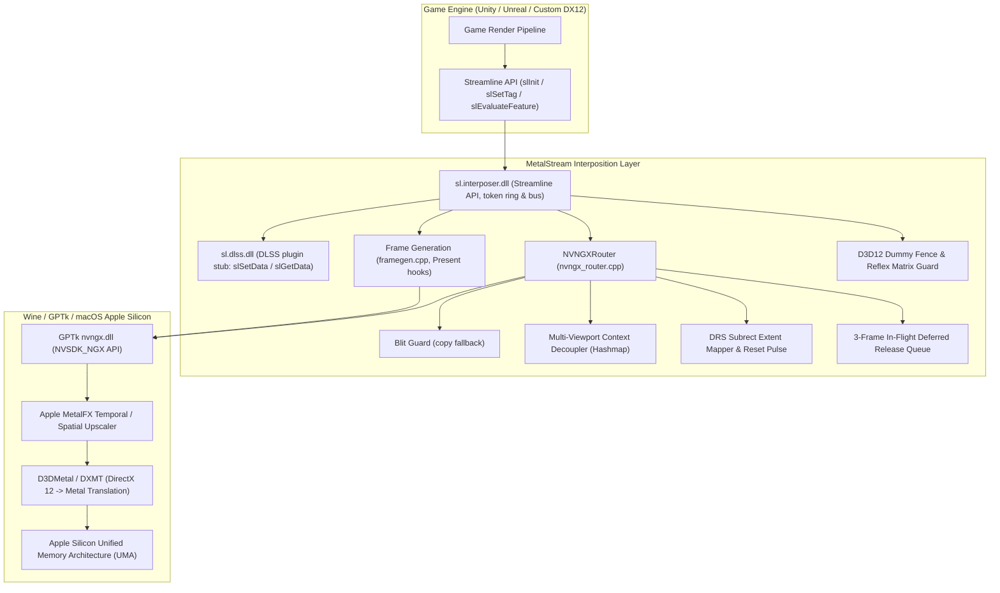

# MetalStream

[English](README.md) | **简体中文** | [繁體中文](README.zh-TW.md)

MetalStream 用来替换 NVIDIA Streamline 的 `sl.interposer.dll` 和 `sl.dlss.dll`，面向通过 Wine、CrossOver、Game Porting Toolkit（GPTk）、MacHoYo 或 Whisky 运行在 Apple Silicon Mac 上的 x86_64 DirectX 12 游戏。游戏向 Streamline 请求 DLSS 超分或 DLSS 帧生成时，MetalStream 把请求交给 GPTk 的 `nvngx.dll`，再由 D3DMetal 调用 Apple 的 MetalFX 完成。

> 本文多处提到的 MacHoYo 是一个 macOS 上的米哈游游戏解决方案，目前还在开发中，尚未发布。

想在游戏里使用的话，下载发布版并按照[安装发布版](#安装发布版)操作即可。只有开发时才需要从源码编译。

## 目录

- [整体结构](#整体结构)
- [功能](#功能)
- [架构](#架构)
  - [阶段 1：内存安全、COM 约定与加锁](#阶段-1内存安全com-约定与加锁)
  - [阶段 2：D3D12 占位 Fence 与 Reflex 矩阵](#阶段-2d3d12-占位-fence-与-reflex-矩阵)
  - [阶段 3：动态分辨率（DRS）与子矩形](#阶段-3动态分辨率drs与子矩形)
  - [阶段 4：多视口与延迟释放](#阶段-4多视口与延迟释放)
  - [阶段 5：资源状态与 Streamline 总线](#阶段-5资源状态与-streamline-总线)
  - [阶段 6：端到端测试](#阶段-6端到端测试)
- [帧生成](#帧生成)
  - [MetalStream 如何生成帧（原型）](#metalstream-如何生成帧原型)
  - [切换 DLSS-G 后的短暂停顿](#切换-dlss-g-后的短暂停顿)
- [安装发布版](#安装发布版)
  - [第 1 步：确认游戏需不需要它](#第-1-步确认游戏需不需要它)
  - [第 2 步：确认启动器支持什么](#第-2-步确认启动器支持什么)
  - [第 3 步：替换两个文件](#第-3-步替换两个文件)
  - [第 4 步：打开功能](#第-4-步打开功能)
  - [第 5 步：检查是否生效](#第-5-步检查是否生效)
  - [还原和常见问题](#还原和常见问题)
  - [启动器和工具开发者](#启动器和工具开发者)
- [构建与测试](#构建与测试)
  - [前置条件（macOS 主机）](#前置条件macos-主机)
  - [编译](#编译)
  - [持续集成与发布](#持续集成与发布)
  - [本机路径](#本机路径)
  - [Wine 回归测试](#wine-回归测试)
- [部署到游戏](#部署到游戏)
  - [备份与部署](#备份与部署)
  - [配置](#配置)
  - [日志](#日志)
- [仓库结构](#仓库结构)
- [贡献者](#贡献者)
- [许可证](#许可证)

## 整体结构



## 功能

- Streamline 接管：实现 Streamline 的生命周期调用（`slInit`、`slShutdown`、`slSetTag`、`slSetConstants`、`slEvaluateFeature`、`slSetData`、`slGetData`），DXGI 和 Direct3D 12 的工厂函数则转发给系统运行库。
- MetalFX 超分：DLSS 请求（`kFeatureDLSS`）经 GPTk 的 `nvngx.dll` 交给 MetalFX 时间性超分。
- DLSS 帧生成：在 D3DMetal 的 NGX `FrameGeneration` 功能（`MTLFXFrameInterpolator`）之上实现 DLSS-G 中 `sl.dlss_g` 那一侧，详见[帧生成](#帧生成)。
- 不要求 HAGS：`slGetFeatureRequirements` 从不报告 `eHardwareSchedulingRequired`，游戏不会因为 Wine 没有硬件加速 GPU 调度而关掉 DLSS 或 DLSS-G。
- Blit Guard：MetalFX 创建或执行失败时，把未缩放的颜色输入复制到输出（`CopyResource`，前后做 `COPY_SOURCE` / `COPY_DEST` 状态转换并在之后恢复），避免出现黑屏帧。
- 无运行时依赖：运行库全部静态链接（`-static -static-libgcc -static-libstdc++`），目标为 Universal CRT。
- MIT 许可：净室实现，可与 MacHoYo、Whisky、DXMT、YAAGL 等 macOS 游戏启动器配合使用。

## 架构

开发分为六个阶段，每个阶段都有对应的测试套件（见 [Wine 回归测试](#wine-回归测试)）。

### 阶段 1：内存安全、COM 约定与加锁

- 通过标签和常量传入的 `IUnknown` / `ID3D12Resource` 指针，保存时调用 `AddRef()`，丢弃时调用 `Release()`，引擎因此不会销毁 MetalStream 仍在使用的资源。
- 帧令牌放在固定 6 个槽位的环形缓冲区里（`frameHandles[sl::MAX_FRAMES_IN_FLIGHT]`，由 `mtxFrameHandle` 保护），不再每帧动态分配。槽位按顺序分配、循环复用，在多线程渲染管线中不会出现令牌冲突或释放后使用。
- 加锁顺序固定：先取接管层外层的 `stateMutex`，再取 `NVNGXRouter::m_mutex`。这样 `slShutdown` 或 `slInit` 与帧评估同时进行时不会死锁。帧生成代码在获取接管层状态锁时，以及在真正调用 `Present` 期间，都不持有自己的 `m_mutex`。

### 阶段 2：D3D12 占位 Fence 与 Reflex 矩阵

- MetalStream 创建一个真实的 D3D12 fence（`m_dummyFence`，通过 `ID3D12Device::CreateFence`），并把它和已发出信号的值填入 `state.inputsProcessingCompletionFence`。没有它的话，引擎在 DLSS 帧生成评估期间调用 `ID3D12CommandQueue::Wait` 会解引用空指针。
- 视图矩阵和投影矩阵默认初始化为 4x4 单位矩阵（$I_4$）。如果引擎在设置相机之前读取 Reflex 延迟常量，拿到的是有效值，不会出现除零或 NaN。
- `sl.interposer.dll` 除 `slGetFeatureFunction` 外还直接导出 `slReflexSetMarker`，供不经过分发表直接调用 Reflex 的引擎使用。

### 阶段 3：动态分辨率（DRS）与子矩形

- 从 `ResourceTag::extent`（`sl::Extent`）读取分辨率和偏移，并遍历所有渲染目标的标签链（`kResourceTagColorIn`、`kResourceTagColorOut`、`kResourceTagMotionVectors`、`kResourceTagDepth`、`kResourceTagHUDLessColor`）。
- 当前 DRS 子矩形写入 NGX 评估参数（`DLSS_Render_Subrect_Dimensions_*`、`DLSS_Input_Color_Subrect_Base_*`、`DLSS_Input_Depth_Subrect_Base_*`、`DLSS_Input_MV_SubrectBase_*`，以及配合 `DLSS_Enable_Output_Subrects` 使用的 `DLSS_Output_Subrect_Base_*`），MetalFX 只缩放视口中实际渲染的部分。
- DRS 分辨率或视口尺寸变化时，只在变化的那一帧发送 `reset = 1`，下一帧立即清除，避免旧的时间历史造成拖影和鬼影。
- NGX 创建标志根据游戏的 DLSS 选项和常量生成：`NVSDK_NGX_DLSS_Feature_Flags_IsHDR`、`MVLowRes`、`MVJittered`、`DepthInverted`、`AutoExposure`、`DoSharpening` 和 `AlphaUpscaling`。

### 阶段 4：多视口与延迟释放

- 每个视口 ID（例如主相机 `0`、镜面 `1`、小地图 `2`）在 `m_viewportContexts` 中有各自的 `NVSDK_NGX_Handle*` 和分辨率状态。一个视口改变分辨率，其他视口不必重建上下文。
- 视口调整大小或被销毁时，旧的 NGX 句柄先在 `m_deferredReleases` 中保留 3 帧，等 GPU 执行完所有可能引用它的命令列表后再释放。
- 实现了 `slAllocateResources` 和 `slFreeResources`，游戏可以提前创建资源，并在确定的时间点释放，与帧评估无关。

### 阶段 5：资源状态与 Streamline 总线

- 超分不改变已标记资源的状态，保持游戏设置的状态（`sl::Resource::state`）。MetalStream 只为自己操作的资源添加状态转换：Blit Guard 的复制（`COPY_SOURCE` / `COPY_DEST`，之后恢复为引擎原来的状态）和帧生成中的复制。
- `sl.interposer.dll` 和 `sl.dlss.dll` 都实现并导出了 `slSetData` 与 `slGetData`，插件之间可以双向传递数据。

### 阶段 6：端到端测试

- `test_streamline_e2e_eval.cpp` 在 Wine + D3DMetal 下运行，覆盖多线程帧令牌压力、多视口、DRS 子矩形映射、资源屏障转换、总线往返和延迟释放。

## 帧生成

### MetalStream 如何生成帧（原型）

这里的 DLSS-G 不需要 NVIDIA 的光流硬件。GPTk 4.0 的 D3DMetal 基于公开的 MetalFX `MTLFXFrameInterpolator` API（macOS 26 及以上）实现了 NGX `FrameGeneration` 功能（即 `nvngx_dlssg` 约定及其 `DLSSG.*` 参数）。只有游戏目录中存在名为 `nvngx_dlssg.dll` 的文件时，D3DMetal 才会启用它；支持 DLSS-G 的游戏本来就带有这个文件。

MetalStream 承担 NVIDIA `sl.dlss_g` 插件的角色（`src/interposer/framegen.cpp`）：

1. 拦截 Present。`slInit` 修改系统 `dxgi.dll` 工厂的虚表，游戏创建的每个交换链的 `Present`、`Present1` 和 `ResizeBuffers` 都会被挂钩。对工厂或交换链调用 `slUpgradeInterface` 的情况也有处理。
2. 插帧。游戏启用 DLSS-G 后（`slDLSSGSetOptions` 设为 `eOn` 或 `eAuto`），每次 `Present` 都会用后台缓冲区、游戏提供的无 HUD 颜色、深度和运动矢量标签，以及 `sl::Constants` 中的相机数据执行 NGX FrameGeneration。D3DMetal 要求运动矢量以运动矢量纹理的像素为单位，所以 Streamline 在 UV 空间下的 `mvecScale` 要乘以运动矢量的分辨率。标记为 `eOnlyValidNow` 的标签在打标签时就复制一份，确保到 `Present` 时仍然有效。
3. 呈现。游戏渲染到代理后台缓冲区（通过挂钩的 `GetBuffer` 和 `GetCurrentBackBufferIndex`），其索引在游戏每次 `Present` 时前进一位，这样自己跟踪后台缓冲区索引的引擎（如 Unity）不会出错。MetalStream 把画面复制到真正的交换链，先呈现插值帧，再呈现真实帧。开启垂直同步时，每次呈现都会等待一次屏幕刷新，两帧因此间隔均匀。
4. 无垂直同步时的帧节奏。`FGPacing=1`（默认）由专门的线程负责呈现，真实帧在生成帧之后半个游戏帧时间呈现，不阻塞游戏线程。呈现频率不会超过屏幕刷新率；游戏帧率高于屏幕时，丢弃过时的帧，只显示真实帧。生成帧期间可以用 `FGMaxGameFps` 限制游戏帧率。`FGPacing=0` 则连续呈现两帧。

`metalstream.ini` 的各个键见[配置](#配置)。用于诊断的选项：

- `FGDebugView=1` 只显示生成帧，用来判断插帧质量。
- `FGCameraData=0` 不再把相机向量和 view-to-clip 矩阵传给插帧器，便于排查相机运动时的画面问题。
- `FGCapture=1` 后按 F10 会把连续 3 帧（真实帧、生成帧、无 HUD 画面、深度、运动矢量、常量）保存到 `metalstream_capture\`，再用 `scripts/analyze_fg_capture.py` 测量生成帧落在两个真实帧之间的位置。

PCL/Reflex 标记会转发给 GPTk 的 `nvapi64.dll`，D3DMetal 据此计算插帧器使用的帧间隔时间。`scripts/run_gptk_tests.sh` 在 Wine + GPTk 下运行真实 GPU 测试：`test_gptk_fg_probe`、分别开关垂直同步的 `test_gptk_framegen_swapchain`，以及 `test_gptk_framegen_lifecycle`（覆盖调整大小、重建交换链和呈现线程运行中调用 `slShutdown`）。

### 切换 DLSS-G 后的短暂停顿

在《绝区零》等游戏中，在设置菜单里切换 DLSS-G 后返回游戏世界，画面可能卡住或黑屏 1 到 2 秒。这段时间里发生了几件事：

- 开关帧生成会改变引擎的呈现模式和交换链缓冲区数量。引擎调用 `IDXGISwapChain::ResizeBuffers`，并销毁旧的后台缓冲区视图。
- 引擎丢弃后处理用的命令列表和管线状态，然后重新创建。
- 《绝区零》的资源流送系统把高分辨率角色网格和 mipmap 重新载入统一内存（约 10 到 12 GB 应用内存、3 到 5 GB Metal 4 驱动分配），GPU 管线在此期间等待同步。

Windows PC 上也会有同样的停顿，这不是内存泄漏。游戏世界加载完成后，MetalFX 时间性超分会恢复到 60+ FPS。

## 安装发布版

这一节写给只想把 MetalStream 放进游戏里用的玩家。你只需要[发布页面](https://github.com/DuolaD/MetalStream/releases)上的 `MetalStream-<版本号>.zip`（例如 `MetalStream-26.10.23.zip`），其他文件是给开发者用的。

### 第 1 步：确认游戏需不需要它

打开游戏的安装文件夹，找一个叫 `sl.interposer.dll` 的文件。在访达里打开这个文件夹，按 ⌘F 输入文件名，然后在"搜索："旁边选这个文件夹的名字，不要选"这台 Mac"。如果游戏装在 CrossOver 里，先在 CrossOver 左侧选中游戏所在的容器，再点右侧"容器操作"里的 **打开 C: 盘**。

- **找到了：**继续往下做，并记住它在哪个文件夹。MetalStream 就放在那个文件夹里。
- **没找到：**这个游戏没有用 NVIDIA Streamline，装 MetalStream 也不会有变化，在启动器里打开 DLSS / MetalFX 就够了。

### 第 2 步：确认启动器支持什么

| 你用的是 | DLSS 超分 | DLSS 帧生成 |
|---|---|---|
| GPTk 4.0 及以上，macOS 26 及以上（例如 MacHoYo） | 支持 | 支持 |
| 自带 GPTk 3.0 的 CrossOver（CrossOver 26 就是） | 大概率可以，尚未测试 | 不支持，需要 GPTk 4.0 |
| 其他 | 装上后按第 5 步检查 | 装上后按第 5 步检查 |

macOS 版本可以在苹果菜单 →"关于本机"里看到。帧生成还要求游戏自己的设置里有 DLSS 帧生成选项。

**查看 CrossOver 自带的 GPTk 版本：**打开"终端"，粘贴下面这行：

```bash
defaults read /Applications/CrossOver.app/Contents/SharedSupport/CrossOver/lib64/apple_gptk/external/D3DMetal.framework/Versions/A/Resources/Info CFBundleShortVersionString
```

显示 `3.0` 就用不了帧生成，显示 `4.0` 或更高才可以。3.0 仍然可以用超分。想用帧生成的话，可以升级到自带 GPTk 4.0 或更高版本的 CrossOver，或者改用其他带 GPTk 4.0 及以上的运行环境。也可以试着用 Apple 的 Game Porting Toolkit 4.0 替换 CrossOver.app 里的 GPTk 文件，但我们没有测试过：GPTk 4.0 把 `nvngx.dll` 改名为 `nvngx-on-metalfx.dll`，CrossOver 的 DLSS 开关可能认不到它，而且每次更新 CrossOver 都会把替换的文件还原。

### 第 3 步：替换两个文件

1. 从最新发布版下载 `MetalStream-<版本号>.zip`，双击解压。
2. 在第 1 步找到的文件夹里，把游戏原来的 `sl.interposer.dll` 改名为 `sl.interposer.dll.orig`，`sl.dlss.dll` 改名为 `sl.dlss.dll.orig`。这两个就是备份。
3. 把解压出来的 `sl.interposer.dll` 和 `sl.dlss.dll` 拖进这个文件夹。
4. 把 `metalstream.ini` 也拖进去，用"文本编辑"打开，把 `EnableLogging=0` 改成 `EnableLogging=1`，这样第 5 步才有日志可看。

### 第 4 步：打开功能

- 在启动器里打开 DLSS / MetalFX。CrossOver 里选中容器，在"高级设置"里把 **图形** 从"自动"改成 **D3DMetal**，再打开 **DLSS**。直接用 Wine 的话，设置环境变量 `D3DM_ENABLE_METALFX=1`。
- 在游戏的图形设置里选择 DLSS。想用帧生成的话，也把 DLSS 帧生成打开。

### 第 5 步：检查是否生效

玩一分钟后退出游戏，打开同一个文件夹里新出现的 `metalstream.log`。在"文本编辑"里按 ⌘F 搜索下面这些内容：

| 你看到的 | 含义 |
|---|---|
| 没有 `metalstream.log` | MetalStream 没有加载：文件放错了文件夹，或者 `EnableLogging` 还是 `0` |
| `MetalFX DLSS feature created successfully` | 超分生效了 |
| `Could not load nvngx.dll` 或 `falling back to BlitGuard` | 启动器的 DLSS / MetalFX 支持没打开或者没有。游戏还能玩，只是没有超分，回去检查第 4 步 |
| `framegen: activated` | 帧生成生效了 |
| `frame generation disabled` | 你的启动器不支持帧生成（见第 2 步） |

确认没问题后，可以把 `EnableLogging` 改回 `0`。

### 还原和常见问题

- **还原：**删掉 MetalStream 的两个 DLL，再把备份文件名里的 `.orig` 去掉。用启动器的"校验 / 修复文件"也可以。
- **游戏更新后 DLSS 没效果了：**更新把原版文件装回去了，重新做一遍第 3 步。
- **游戏打不开或者崩溃：**先还原，然后[提交 issue](https://github.com/DuolaD/MetalStream/issues) 并附上 `metalstream.log`。

### 启动器和工具开发者

每个发布版都附带由 GitHub Actions 根据该版本标签编译的文件，`<版本号>` 就是标签名：

| 文件 | 内容 |
|---|---|
| `MetalStream-<版本号>.zip` | `sl.interposer.dll`、`sl.dlss.dll`、示例 `metalstream.ini` 和许可证 |
| `MetalStream-<版本号>-debug-symbols.zip` | 两个 DLL 的调试信息，只在分析崩溃时需要 |
| `SHA256SUMS` | 两个压缩包的 SHA-256 校验值 |

| 运行环境 | DLSS 超分 | DLSS 帧生成 |
|---|---|---|
| GPTk 4.0 及以上的 D3DMetal，macOS 26 及以上（例如 MacHoYo 的运行环境） | 支持，已测试 | 支持，已用《绝区零》测试 |
| CrossOver 26.3（自带 D3DMetal 3.0） | 应该可用，尚未测试 | 不支持，D3DMetal 3.0 没有帧生成 |
| DXMT 后端 | 未测试 | 未测试 |

- 文件名里带版本号，所以没有固定的下载链接。请向 `https://api.github.com/repos/DuolaD/MetalStream/releases/latest` 查询最新发布版，取名为 `MetalStream-*.zip` 且不以 `-debug-symbols.zip` 结尾的附件。这个接口会跳过预发布版。下载后请用同一版本的 `SHA256SUMS` 校验。
- 安装做的事和上面玩家的步骤相同：把两个 DLL 复制到游戏的 `sl.interposer.dll` 旁边，保留原文件用于卸载时恢复，并以 `D3DM_ENABLE_METALFX=1` 启动游戏。
- 只有游戏目录中存在名为 `nvngx_dlssg.dll` 的文件时，D3DMetal 才会开启帧生成。带 DLSS-G 的游戏自带这个文件，不要删除。
- 只分发 MetalStream 自己的文件。`nvngx_dlssg.dll` 属于 NVIDIA，D3DMetal 和 `nvngx.dll` 属于 Apple。
- 设置 `METALSTREAM_LOG=1` 可以不改 ini 就打开日志。其他设置见[配置](#配置)。

## 构建与测试

### 前置条件（macOS 主机）

用 Homebrew 安装 MinGW-w64、CMake 和 Ninja：

```bash
brew install mingw-w64 cmake ninja
```

### 编译

```bash
# Configure build directory
cmake -B build -G Ninja -DCMAKE_TOOLCHAIN_FILE=cmake/x86_64-w64-mingw32.cmake

# Build binaries and all test executables
ninja -C build

# ctest runs the mock pipeline test under Wine; tell CMake which Wine to use
cmake -B build -DMETALSTREAM_WINE=/path/to/wine/bin/wine
(cd build && ctest)

# Package the release files into dist/: MetalStream-<version>.zip, MetalStream-<version>-debug-symbols.zip, SHA256SUMS
scripts/package.sh 26.10.23
```

### 持续集成与发布

- `.github/workflows/build.yml` 在每次推送到 `main` 和每个 Pull Request 时运行。它在 Fedora 容器中用面向 Universal CRT 的 MinGW GCC 编译（`MINGW_PREFIX=x86_64-w64-mingw32ucrt`，即工具链文件支持的覆盖项），在 Wine 下运行模拟管线测试，并运行 `scripts/package.sh`。运行结果里的 `dist` 产物和发布版的文件相同。
- `.github/workflows/release.yml` 在 GitHub 上发布 Release 时运行，编译该版本的标签，并把 `MetalStream-<标签>.zip`、`MetalStream-<标签>-debug-symbols.zip` 和 `SHA256SUMS` 附加到这个 Release。非发布版的构建以提交号命名，例如 `MetalStream-dev-1a2b3c4.zip`。要重新编译已有的版本，在 Actions 页面手动运行 Release 工作流并填写标签。
- CI 没有 GPU，不会运行 D3D12 测试套件和 GPTk 帧生成测试。发布前请在本机运行这些测试和 `scripts/run_gptk_tests.sh`。

### 本机路径

辅助脚本从环境变量或 `scripts/local.env`（已被 git 忽略）读取与本机相关的路径：

```bash
cp scripts/local.env.example scripts/local.env   # then edit METALSTREAM_GAME_DIR, WINE_BIN, WINEPREFIX
```

### Wine 回归测试

`build/` 中的 `test_*.exe` 需要真实的 D3D12 设备，因此要在带 GPTk 的 Wine 运行环境（例如 MacHoYo 自带的）中运行，而不是通过 ctest。核心测试如下：

```bash
export WINEMSYNC=1
export WINEPREFIX="/path/to/wineprefix"
WINE="/path/to/wine/bin/wine"

cd build
$WINE test_streamline.exe            # Streamline API & HAGS requirement
$WINE test_phase1_stability.exe      # COM AddRef, FrameToken ring, deadlock test
$WINE test_phase2_defense.exe        # D3D12 dummy fence, queue Wait & Reflex
$WINE test_phase3_drs.exe            # Dynamic resolution scaling & subrect mapping
$WINE test_phase4_viewport.exe       # Multi-viewport contexts & deferred release
$WINE test_phase5_barriers_bus.exe   # D3D12 barriers & unified bus
$WINE test_streamline_e2e_eval.exe   # End-to-end integration
```

`test_part*` 和 `test_audit*` 是额外的约定、并发和回归审查测试，运行方式相同。ctest 只运行 `build/mock/test_mock_pipeline.exe`，它使用模拟的 `nvngx.dll`，不需要 GPU。`build/gptk/` 中的帧生成测试通过 `scripts/run_gptk_tests.sh` 运行。

## 部署到游戏

### 备份与部署

`scripts/deploy.sh [game_dir]` 会编译、去除符号并把两个 DLL 复制到游戏目录，游戏原有的文件保存为 `*.orig`；`scripts/restore.sh [game_dir]` 把原文件恢复回去。不带参数时，两个脚本都使用 `METALSTREAM_GAME_DIR`。手动操作的话，先备份可用的 DLL：

```bash
GAME_DIR="/path/to/game"   # the folder that holds sl.interposer.dll

# 1. Backup existing working DLLs
cp "$GAME_DIR/sl.interposer.dll" "$GAME_DIR/sl.interposer.dll.working_bak"
cp "$GAME_DIR/sl.dlss.dll" "$GAME_DIR/sl.dlss.dll.working_bak"

# 2. Deploy stripped release DLLs
cp build/sl.interposer.dll "$GAME_DIR/sl.interposer.dll"
cp build/sl.dlss.dll "$GAME_DIR/sl.dlss.dll"

# 3. Verify MD5 checksums
md5 "$GAME_DIR"/sl.interposer.dll* "$GAME_DIR"/sl.dlss.dll*
```

### 配置

配置文件 `metalstream.ini` 是可选的，放在 `sl.interposer.dll` 旁边，节名为 `[MetalStream]`。缺少某个键或整个文件时，使用下表中的默认值。超出范围或不是数字的值会被修正，并在日志中给出警告。启动时日志会输出一行 `config:`，列出每一项的实际值以及它来自 ini 文件还是默认值。这些键定义在 `src/common/config.cpp` 中。

| 键 | 默认值 | 有效值 | 含义 |
|---|---|---|---|
| `EnableLogging` | `0` | `0`、`1` | 写入 `metalstream.log` |
| `Debug` | `0` | `0`、`1` | 输出详细的逐帧日志（需 `EnableLogging=1`） |
| `FrameGeneration` | `1` | `0`、`1` | `0` 强制关闭 DLSS-G 帧生成，`1` 跟随游戏设置 |
| `FGDebugView` | `0` | `0`、`1` | `1` 只呈现生成帧 |
| `FGPacing` | `1` | `0`、`1` | 无垂直同步时：`1` 由专门线程按节奏呈现，`0` 连续呈现 |
| `FGMaxGameFps` | `0` | `-1` 到 `1000`（超出则截断） | 无垂直同步且生成帧时的游戏帧率上限：`0` 不限制，`-1` 为屏幕刷新率的一半，`N` 为 N fps |
| `FGCameraData` | `1` | `0`、`1` | 把相机向量和 view-to-clip 矩阵传给插帧器 |
| `FGCapture` | `0` | `0`、`1`、`2` | `1` 按 F10 保存 3 帧到 `metalstream_capture\`，`2` 另外自动抓取一次（用于测试） |

开关类的键取值无效时回退到默认值，`FGMaxGameFps` 会被截断到有效范围内。设置环境变量 `METALSTREAM_LOG=1` / `METALSTREAM_DEBUG=1`，或放置 `metalstream.debug` 标记文件，也可以开启日志。

### 日志

MetalStream 在游戏目录中写入 `metalstream.log`，记录接管、打标签、屏障转换和评估过程。

## 仓库结构

```
MetalStream/
├── .github/workflows/
│   ├── build.yml                      # CI: build, mock test under Wine, package (push / pull request)
│   └── release.yml                    # Builds a published release and attaches its files
├── cmake/
│   └── x86_64-w64-mingw32.cmake      # MinGW-w64 cross-compilation toolchain
├── include/
│   ├── streamline/                    # NVIDIA Streamline SDK headers (sl.h, sl_dlss.h, sl_dlss_g.h, sl_reflex.h, sl_pcl.h, ...)
│   └── nvngx/                         # NVIDIA NGX SDK headers (nvsdk_ngx.h, nvsdk_ngx_defs.h, nvsdk_ngx_params.h, ...)
├── src/
│   ├── common/
│   │   ├── logger.h / logger.cpp      # Thread-safe logger (metalstream.log)
│   │   └── config.h / config.cpp      # metalstream.ini keys, defaults & validation
│   ├── interposer/                    # sl.interposer.dll
│   │   ├── dllmain.cpp                # DLL entry point
│   │   ├── dxgi_proxy.cpp/.h          # DXGI factory forwarding to the system dxgi.dll
│   │   ├── d3d12_proxy.cpp/.h         # Direct3D 12 forwarding to the system d3d12.dll
│   │   ├── nvngx_router.cpp/.h        # GPTk nvngx.dll routing, multi-viewport, DRS, Blit Guard
│   │   ├── framegen.cpp/.h            # DLSS-G frame generation (Present hooks, pacing, capture)
│   │   ├── metalstream_diag.h         # Diagnostic counters
│   │   └── sl_interposer.cpp          # Streamline API interposition & token ring
│   └── dlss/
│       └── sl_dlss.cpp                # sl.dlss.dll plugin stub (slSetData / slGetData, resources)
├── scripts/
│   ├── deploy.sh / restore.sh         # Deploy to / restore a game directory
│   ├── package.sh                     # Build the release archives and SHA256SUMS in dist/
│   ├── run_gptk_tests.sh              # Real-GPU frame generation tests under Wine + GPTk
│   ├── analyze_fg_capture.py          # Analyze FGCapture dumps
│   ├── common.sh                      # Shared helpers (reads scripts/local.env)
│   └── local.env.example              # Template for machine-specific paths
├── tests/
│   ├── mock/                          # Mock nvngx.dll + fake D3D12 objects (test_mock_pipeline)
│   ├── test_streamline.cpp            # Core Streamline & HAGS requirement suite
│   ├── test_phase1..5_*.cpp           # Stability, fence/Reflex, DRS, viewports, bus
│   ├── test_part1..5_*.cpp            # Contract & concurrency audits
│   ├── test_audit2..7_*.cpp           # Regression audits
│   ├── test_gptk_*.cpp                # Real-GPU frame generation tests (GPTk)
│   ├── test_mock_pipeline.cpp         # Behavior test run by ctest
│   └── test_streamline_e2e_eval.cpp   # End-to-end integration test
├── metalstream.ini                    # Sample configuration
├── CMakeLists.txt                     # CMake build configuration
├── README.md                          # English documentation
├── README.zh-CN.md                    # Simplified Chinese documentation
└── README.zh-TW.md                    # Traditional Chinese documentation
```

## 贡献者

- [DuolaD](https://github.com/DuolaD)

## 许可证

MetalStream 以 [MIT 许可证](LICENSE)发布。
