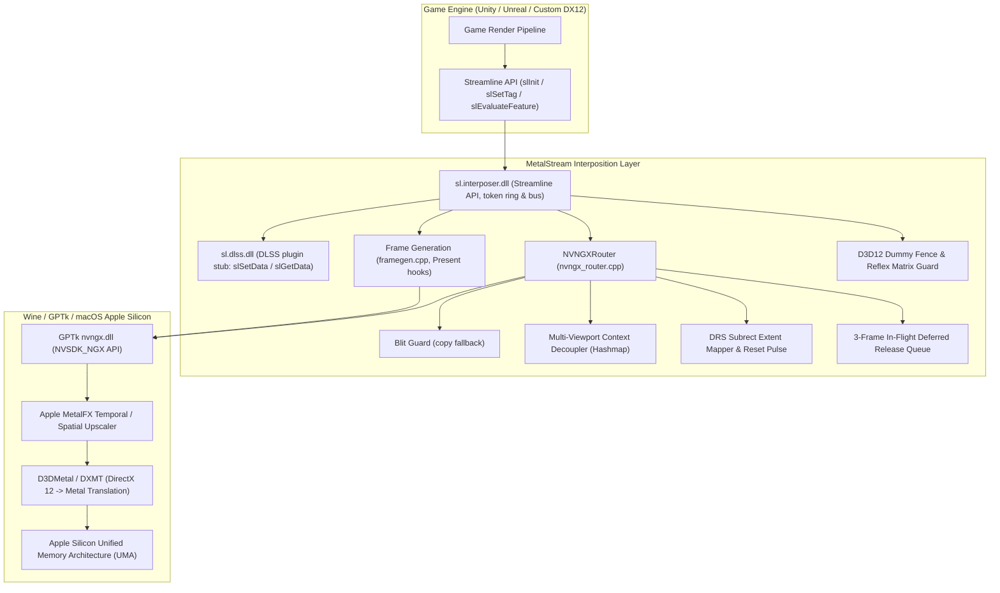

# MetalStream

[English](README.md) | [简体中文](README.zh-CN.md) | **繁體中文**

MetalStream 用來取代 NVIDIA Streamline 的 `sl.interposer.dll` 和 `sl.dlss.dll`，對象是透過 Wine、CrossOver、Game Porting Toolkit（GPTk）、MacHoYo 或 Whisky 在 Apple Silicon Mac 上執行的 x86_64 DirectX 12 遊戲。遊戲向 Streamline 要求 DLSS 超解析度或 DLSS 畫格生成時，MetalStream 把要求交給 GPTk 的 `nvngx.dll`，再由 D3DMetal 呼叫 Apple 的 MetalFX 完成。

> 本文多處提到的 MacHoYo 是一個 macOS 上的米哈遊遊戲解決方案，目前仍在開發中，尚未發布。

想在遊戲裡使用的話，下載發行版並依照[安裝發行版](#安裝發行版)操作即可。只有開發時才需要從原始碼編譯。

## 目錄

- [整體架構](#整體架構)
- [功能](#功能)
- [架構](#架構)
  - [階段 1：記憶體安全、COM 約定與鎖定](#階段-1記憶體安全com-約定與鎖定)
  - [階段 2：D3D12 替代 Fence 與 Reflex 矩陣](#階段-2d3d12-替代-fence-與-reflex-矩陣)
  - [階段 3：動態解析度（DRS）與子矩形](#階段-3動態解析度drs與子矩形)
  - [階段 4：多視口與延遲釋放](#階段-4多視口與延遲釋放)
  - [階段 5：資源狀態與 Streamline 匯流排](#階段-5資源狀態與-streamline-匯流排)
  - [階段 6：端對端測試](#階段-6端對端測試)
- [畫格生成](#畫格生成)
  - [MetalStream 如何產生畫格（原型）](#metalstream-如何產生畫格原型)
  - [切換 DLSS-G 後的短暫停頓](#切換-dlss-g-後的短暫停頓)
- [安裝發行版](#安裝發行版)
  - [第 1 步：確認遊戲需不需要它](#第-1-步確認遊戲需不需要它)
  - [第 2 步：確認啟動器支援什麼](#第-2-步確認啟動器支援什麼)
  - [第 3 步：替換兩個檔案](#第-3-步替換兩個檔案)
  - [第 4 步：打開功能](#第-4-步打開功能)
  - [第 5 步：檢查是否生效](#第-5-步檢查是否生效)
  - [還原和常見問題](#還原和常見問題)
  - [啟動器和工具開發者](#啟動器和工具開發者)
- [建置與測試](#建置與測試)
  - [必要條件（macOS 主機）](#必要條件macos-主機)
  - [編譯](#編譯)
  - [持續整合與發行](#持續整合與發行)
  - [本機路徑](#本機路徑)
  - [Wine 迴歸測試](#wine-迴歸測試)
- [部署到遊戲](#部署到遊戲)
  - [備份與部署](#備份與部署)
  - [設定](#設定)
  - [記錄](#記錄)
- [儲存庫結構](#儲存庫結構)
- [貢獻者](#貢獻者)
- [授權](#授權)

## 整體架構



## 功能

- 接管 Streamline：實作 Streamline 的生命週期呼叫（`slInit`、`slShutdown`、`slSetTag`、`slSetConstants`、`slEvaluateFeature`、`slSetData`、`slGetData`），DXGI 與 Direct3D 12 的工廠函式則轉送給系統執行階段。
- MetalFX 超解析度：DLSS 要求（`kFeatureDLSS`）經 GPTk 的 `nvngx.dll` 交給 MetalFX 時間性超解析度。
- DLSS 畫格生成：在 D3DMetal 的 NGX `FrameGeneration` 功能（`MTLFXFrameInterpolator`）之上實作 DLSS-G 中 `sl.dlss_g` 那一側，詳見[畫格生成](#畫格生成)。
- 不需要 HAGS：`slGetFeatureRequirements` 從不回報 `eHardwareSchedulingRequired`，遊戲不會因為 Wine 沒有硬體加速 GPU 排程而關掉 DLSS 或 DLSS-G。
- Blit Guard：MetalFX 建立或執行失敗時，把未縮放的色彩輸入複製到輸出（`CopyResource`，前後做 `COPY_SOURCE` / `COPY_DEST` 狀態轉換並在之後還原），避免出現黑畫面。
- 沒有執行階段相依性：執行階段程式庫全部靜態連結（`-static -static-libgcc -static-libstdc++`），目標為 Universal CRT。
- MIT 授權：無塵室實作，可搭配 MacHoYo、Whisky、DXMT、YAAGL 等 macOS 遊戲啟動器使用。

## 架構

開發分為六個階段，每個階段都有對應的測試套件（見 [Wine 迴歸測試](#wine-迴歸測試)）。

### 階段 1：記憶體安全、COM 約定與鎖定

- 透過標籤和常數傳入的 `IUnknown` / `ID3D12Resource` 指標，儲存時呼叫 `AddRef()`，捨棄時呼叫 `Release()`，引擎因此不會銷毀 MetalStream 仍在使用的資源。
- 畫格權杖放在固定 6 個槽位的環狀緩衝區（`frameHandles[sl::MAX_FRAMES_IN_FLIGHT]`，由 `mtxFrameHandle` 保護），不再每畫格動態配置。槽位依序配置、循環重複使用，在多執行緒算繪管線中不會發生權杖衝突或釋放後使用。
- 鎖定順序固定：先取接管層外層的 `stateMutex`，再取 `NVNGXRouter::m_mutex`。這樣 `slShutdown` 或 `slInit` 與畫格評估同時進行時不會死結。畫格生成程式碼在取得接管層狀態鎖時，以及實際呼叫 `Present` 期間，都不持有自己的 `m_mutex`。

### 階段 2：D3D12 替代 Fence 與 Reflex 矩陣

- MetalStream 建立一個真正的 D3D12 fence（`m_dummyFence`，透過 `ID3D12Device::CreateFence`），並把它和已發出訊號的值填入 `state.inputsProcessingCompletionFence`。少了它，引擎在 DLSS 畫格生成評估期間呼叫 `ID3D12CommandQueue::Wait` 時會解參考空指標。
- 檢視矩陣和投影矩陣預設初始化為 4x4 單位矩陣（$I_4$）。引擎若在設定攝影機之前讀取 Reflex 延遲常數，拿到的是有效值，不會出現除以零或 NaN。
- `sl.interposer.dll` 除了 `slGetFeatureFunction`，也直接匯出 `slReflexSetMarker`，供不經過分派表、直接呼叫 Reflex 的引擎使用。

### 階段 3：動態解析度（DRS）與子矩形

- 從 `ResourceTag::extent`（`sl::Extent`）讀取解析度和位移，並走訪所有算繪目標的標籤鏈（`kResourceTagColorIn`、`kResourceTagColorOut`、`kResourceTagMotionVectors`、`kResourceTagDepth`、`kResourceTagHUDLessColor`）。
- 目前的 DRS 子矩形寫入 NGX 評估參數（`DLSS_Render_Subrect_Dimensions_*`、`DLSS_Input_Color_Subrect_Base_*`、`DLSS_Input_Depth_Subrect_Base_*`、`DLSS_Input_MV_SubrectBase_*`，以及搭配 `DLSS_Enable_Output_Subrects` 使用的 `DLSS_Output_Subrect_Base_*`），讓 MetalFX 只縮放視口中實際算繪的部分。
- DRS 解析度或視口尺寸改變時，只在改變的那一畫格送出 `reset = 1`，下一畫格立即清除，避免舊的時間歷史造成拖影和殘影。
- NGX 建立旗標依遊戲的 DLSS 選項和常數產生：`NVSDK_NGX_DLSS_Feature_Flags_IsHDR`、`MVLowRes`、`MVJittered`、`DepthInverted`、`AutoExposure`、`DoSharpening` 和 `AlphaUpscaling`。

### 階段 4：多視口與延遲釋放

- 每個視口 ID（例如主攝影機 `0`、鏡面 `1`、小地圖 `2`）在 `m_viewportContexts` 中都有自己的 `NVSDK_NGX_Handle*` 和解析度狀態。一個視口改變解析度時，其他視口不必重新建立。
- 視口調整大小或被銷毀時，舊的 NGX 控制代碼先在 `m_deferredReleases` 中保留 3 個畫格，等 GPU 執行完所有可能參考它的命令清單後才釋放。
- 實作了 `slAllocateResources` 和 `slFreeResources`，遊戲可以預先建立資源，並在明確的時間點釋放，與畫格評估無關。

### 階段 5：資源狀態與 Streamline 匯流排

- 超解析度不會改變已標記資源的狀態，維持遊戲設定的狀態（`sl::Resource::state`）。MetalStream 只為自己操作的資源加上狀態轉換：Blit Guard 的複製（`COPY_SOURCE` / `COPY_DEST`，之後還原為引擎原本的狀態）以及畫格生成中的複製。
- `sl.interposer.dll` 和 `sl.dlss.dll` 都實作並匯出 `slSetData` 與 `slGetData`，外掛程式之間可以雙向傳遞資料。

### 階段 6：端對端測試

- `test_streamline_e2e_eval.cpp` 在 Wine + D3DMetal 下執行，涵蓋多執行緒畫格權杖壓力測試、多視口、DRS 子矩形對應、資源屏障轉換、匯流排往返和延遲釋放。

## 畫格生成

### MetalStream 如何產生畫格（原型）

這裡的 DLSS-G 不需要 NVIDIA 的光流硬體。GPTk 4.0 的 D3DMetal 以公開的 MetalFX `MTLFXFrameInterpolator` API（macOS 26 以上）實作了 NGX `FrameGeneration` 功能（即 `nvngx_dlssg` 約定及其 `DLSSG.*` 參數）。只有遊戲目錄中有名為 `nvngx_dlssg.dll` 的檔案時，D3DMetal 才會啟用它；支援 DLSS-G 的遊戲本來就附有這個檔案。

MetalStream 扮演 NVIDIA `sl.dlss_g` 外掛程式的角色（`src/interposer/framegen.cpp`）：

1. 攔截 Present。`slInit` 修改系統 `dxgi.dll` 工廠的虛擬函式表，遊戲建立的每個交換鏈的 `Present`、`Present1` 和 `ResizeBuffers` 都會被掛鉤。對工廠或交換鏈呼叫 `slUpgradeInterface` 的情況也有處理。
2. 插補畫格。遊戲啟用 DLSS-G 後（`slDLSSGSetOptions` 設為 `eOn` 或 `eAuto`），每次 `Present` 都會用背景緩衝區、遊戲提供的無 HUD 色彩、深度和動態向量標籤，以及 `sl::Constants` 中的攝影機資料執行 NGX FrameGeneration。D3DMetal 要求動態向量以動態向量紋理的像素為單位，所以 Streamline 在 UV 空間下的 `mvecScale` 要乘上動態向量的解析度。標記為 `eOnlyValidNow` 的標籤在加上標籤時就先複製一份，確保到 `Present` 時仍然有效。
3. 呈現。遊戲算繪到代理背景緩衝區（透過掛鉤的 `GetBuffer` 和 `GetCurrentBackBufferIndex`），其索引在遊戲每次 `Present` 時前進一位，所以自行追蹤背景緩衝區索引的引擎（如 Unity）不會出錯。MetalStream 把畫面複製到真正的交換鏈，先呈現插補畫格，再呈現真實畫格。開啟垂直同步時，每次呈現都會等待一次螢幕更新，兩個畫格因此間隔平均。
4. 未開垂直同步時的畫格節奏。`FGPacing=1`（預設）由專用執行緒負責呈現，真實畫格在產生的畫格之後半個遊戲畫格時間才呈現，不會阻塞遊戲執行緒。呈現頻率不會超過螢幕更新率；遊戲畫格率高於螢幕時，捨棄過時的畫格，只顯示真實畫格。產生畫格期間可以用 `FGMaxGameFps` 限制遊戲畫格率。`FGPacing=0` 則連續呈現兩個畫格。

`metalstream.ini` 的各個鍵見[設定](#設定)。用於診斷的選項：

- `FGDebugView=1` 只顯示產生的畫格，用來判斷插補品質。
- `FGCameraData=0` 不再把攝影機向量和 view-to-clip 矩陣傳給插補器，方便排查攝影機移動時的畫面問題。
- `FGCapture=1` 之後按 F10 會把連續 3 個畫格（真實畫格、產生的畫格、無 HUD 畫面、深度、動態向量、常數）存到 `metalstream_capture\`，再用 `scripts/analyze_fg_capture.py` 測量產生的畫格落在兩個真實畫格之間的哪個位置。

PCL/Reflex 標記會轉送給 GPTk 的 `nvapi64.dll`，D3DMetal 據此計算插補器使用的畫格間隔時間。`scripts/run_gptk_tests.sh` 在 Wine + GPTk 下執行真實 GPU 測試：`test_gptk_fg_probe`、分別開關垂直同步的 `test_gptk_framegen_swapchain`，以及 `test_gptk_framegen_lifecycle`（涵蓋調整大小、重新建立交換鏈，以及呈現執行緒執行中呼叫 `slShutdown`）。

### 切換 DLSS-G 後的短暫停頓

在《絕區零》等遊戲中，於設定選單切換 DLSS-G 後回到遊戲世界，畫面可能凍結或黑畫面 1 到 2 秒。這段時間裡發生了幾件事：

- 開關畫格生成會改變引擎的呈現模式和交換鏈緩衝區數量。引擎呼叫 `IDXGISwapChain::ResizeBuffers`，並銷毀舊的背景緩衝區檢視。
- 引擎捨棄後製處理用的命令清單和管線狀態，然後重新建立。
- 《絕區零》的資源串流系統把高解析度角色網格和 mipmap 重新載入統一記憶體（約 10 到 12 GB 應用程式記憶體、3 到 5 GB Metal 4 驅動程式配置），GPU 管線在這段期間等待同步。

Windows PC 上也有同樣的停頓，這不是記憶體流失。遊戲世界載入完成後，MetalFX 時間性超解析度會回到 60+ FPS。

## 安裝發行版

這一節寫給只想把 MetalStream 放進遊戲裡用的玩家。你只需要[發行頁面](https://github.com/DuolaD/MetalStream/releases)上的 `MetalStream-<版本號>.zip`（例如 `MetalStream-26.10.23.zip`），其他檔案是給開發者用的。

### 第 1 步：確認遊戲需不需要它

打開遊戲的安裝資料夾，找一個叫 `sl.interposer.dll` 的檔案。在 Finder 裡打開這個資料夾，按 ⌘F 輸入檔名，然後在「搜尋：」旁邊選這個資料夾的名稱，不要選「這台 Mac」。如果遊戲裝在 CrossOver 裡，先在 CrossOver 左側選取遊戲所在的容器（Bottle），再點右側「容器操作」裡的 **打开 C: 盘**（英文介面為 Open C: Drive）。

- **找到了：**繼續往下做，並記住它在哪個資料夾。MetalStream 就放在那個資料夾裡。
- **沒找到：**這個遊戲沒有用 NVIDIA Streamline，裝 MetalStream 也不會有變化，在啟動器裡打開 DLSS / MetalFX 就夠了。

### 第 2 步：確認啟動器支援什麼

| 你用的是 | DLSS 超解析度 | DLSS 畫格生成 |
|---|---|---|
| GPTk 4.0 以上，macOS 26 以上（例如 MacHoYo） | 支援 | 支援 |
| 內附 GPTk 3.0 的 CrossOver（CrossOver 26 就是） | 應該可以，尚未測試 | 不支援，需要 GPTk 4.0 |
| 其他 | 裝上後依第 5 步檢查 | 裝上後依第 5 步檢查 |

macOS 版本可以在蘋果選單 →「關於這台 Mac」裡看到。畫格生成還需要遊戲本身的設定裡有 DLSS 畫格生成選項。

**查看 CrossOver 內附的 GPTk 版本：**打開「終端機」，貼上下面這行：

```bash
defaults read /Applications/CrossOver.app/Contents/SharedSupport/CrossOver/lib64/apple_gptk/external/D3DMetal.framework/Versions/A/Resources/Info CFBundleShortVersionString
```

顯示 `3.0` 就用不了畫格生成，顯示 `4.0` 或更高才可以。3.0 仍然可以用超解析度。想用畫格生成的話，可以升級到內附 GPTk 4.0 或更高版本的 CrossOver，或者改用其他含 GPTk 4.0 以上的執行環境。也可以試著用 Apple 的 Game Porting Toolkit 4.0 取代 CrossOver.app 裡的 GPTk 檔案，但我們沒有測試過：GPTk 4.0 把 `nvngx.dll` 改名為 `nvngx-on-metalfx.dll`，CrossOver 的 DLSS 開關可能認不到它，而且每次更新 CrossOver 都會把取代的檔案還原。

### 第 3 步：替換兩個檔案

1. 從最新發行版下載 `MetalStream-<版本號>.zip`，按兩下解壓縮。
2. 在第 1 步找到的資料夾裡，把遊戲原本的 `sl.interposer.dll` 改名為 `sl.interposer.dll.orig`，`sl.dlss.dll` 改名為 `sl.dlss.dll.orig`。這兩個就是備份。
3. 把解壓出來的 `sl.interposer.dll` 和 `sl.dlss.dll` 拖進這個資料夾。
4. 把 `metalstream.ini` 也拖進去，用「文字編輯」打開，把 `EnableLogging=0` 改成 `EnableLogging=1`，這樣第 5 步才有記錄可看。

### 第 4 步：打開功能

- 在啟動器裡打開 DLSS / MetalFX。CrossOver 裡選取容器，在「高级设置」（英文介面為 Advanced Settings）裡把 **图形**（Graphics）從「自动」改成 **D3DMetal**，再打開 **DLSS**。直接用 Wine 的話，設定環境變數 `D3DM_ENABLE_METALFX=1`。
- 在遊戲的圖形設定裡選擇 DLSS。想用畫格生成的話，也把 DLSS 畫格生成打開。

### 第 5 步：檢查是否生效

玩一分鐘後結束遊戲，打開同一個資料夾裡新出現的 `metalstream.log`。在「文字編輯」裡按 ⌘F 搜尋下面這些內容：

| 你看到的 | 意思 |
|---|---|
| 沒有 `metalstream.log` | MetalStream 沒有載入：檔案放錯了資料夾，或者 `EnableLogging` 還是 `0` |
| `MetalFX DLSS feature created successfully` | 超解析度生效了 |
| `Could not load nvngx.dll` 或 `falling back to BlitGuard` | 啟動器的 DLSS / MetalFX 支援沒打開或者沒有。遊戲還能玩，只是沒有超解析度，回去檢查第 4 步 |
| `framegen: activated` | 畫格生成生效了 |
| `frame generation disabled` | 你的啟動器不支援畫格生成（見第 2 步） |

確認沒問題後，可以把 `EnableLogging` 改回 `0`。

### 還原和常見問題

- **還原：**刪掉 MetalStream 的兩個 DLL，再把備份檔名裡的 `.orig` 拿掉。用啟動器的「驗證 / 修復檔案」也可以。
- **遊戲更新後 DLSS 沒效果了：**更新把原版檔案裝回去了，重新做一遍第 3 步。
- **遊戲打不開或者當機：**先還原，然後[提交 issue](https://github.com/DuolaD/MetalStream/issues) 並附上 `metalstream.log`。

### 啟動器和工具開發者

每個發行版都附有由 GitHub Actions 依該版本標籤編譯的檔案，`<版本號>` 就是標籤名稱：

| 檔案 | 內容 |
|---|---|
| `MetalStream-<版本號>.zip` | `sl.interposer.dll`、`sl.dlss.dll`、範例 `metalstream.ini` 和授權條款 |
| `MetalStream-<版本號>-debug-symbols.zip` | 兩個 DLL 的除錯資訊，只在分析當機時需要 |
| `SHA256SUMS` | 兩個壓縮檔的 SHA-256 檢查碼 |

| 執行環境 | DLSS 超解析度 | DLSS 畫格生成 |
|---|---|---|
| GPTk 4.0 以上的 D3DMetal，macOS 26 以上（例如 MacHoYo 的執行環境） | 支援，已測試 | 支援，已用《絕區零》測試 |
| CrossOver 26.3（內附 D3DMetal 3.0） | 應該可用，尚未測試 | 不支援，D3DMetal 3.0 沒有畫格生成 |
| DXMT 後端 | 未測試 | 未測試 |

- 檔名裡帶有版本號，所以沒有固定的下載連結。請向 `https://api.github.com/repos/DuolaD/MetalStream/releases/latest` 查詢最新發行版，取名為 `MetalStream-*.zip` 且不以 `-debug-symbols.zip` 結尾的附件。這個介面會略過預先發行版。下載後請用同一版本的 `SHA256SUMS` 驗證。
- 安裝做的事和上面玩家的步驟相同：把兩個 DLL 複製到遊戲的 `sl.interposer.dll` 旁邊，保留原檔以便解除安裝時還原，並以 `D3DM_ENABLE_METALFX=1` 啟動遊戲。
- 只有遊戲目錄中存在名為 `nvngx_dlssg.dll` 的檔案時，D3DMetal 才會開啟畫格生成。有 DLSS-G 的遊戲本身就附有這個檔案，不要刪除。
- 只散布 MetalStream 自己的檔案。`nvngx_dlssg.dll` 屬於 NVIDIA，D3DMetal 和 `nvngx.dll` 屬於 Apple。
- 設定 `METALSTREAM_LOG=1` 可以不改 ini 就開啟記錄。其他設定見[設定](#設定)。

## 建置與測試

### 必要條件（macOS 主機）

用 Homebrew 安裝 MinGW-w64、CMake 和 Ninja：

```bash
brew install mingw-w64 cmake ninja
```

### 編譯

```bash
# Configure build directory
cmake -B build -G Ninja -DCMAKE_TOOLCHAIN_FILE=cmake/x86_64-w64-mingw32.cmake

# Build binaries and all test executables
ninja -C build

# ctest runs the mock pipeline test under Wine; tell CMake which Wine to use
cmake -B build -DMETALSTREAM_WINE=/path/to/wine/bin/wine
(cd build && ctest)

# Package the release files into dist/: MetalStream-<version>.zip, MetalStream-<version>-debug-symbols.zip, SHA256SUMS
scripts/package.sh 26.10.23
```

### 持續整合與發行

- `.github/workflows/build.yml` 在每次推送到 `main` 和每個 Pull Request 時執行。它在 Fedora 容器中以針對 Universal CRT 的 MinGW GCC 編譯（`MINGW_PREFIX=x86_64-w64-mingw32ucrt`，即工具鏈檔案支援的覆寫項），在 Wine 下執行模擬管線測試，並執行 `scripts/package.sh`。執行結果裡的 `dist` 產物和發行版的檔案相同。
- `.github/workflows/release.yml` 在 GitHub 上發布 Release 時執行，編譯該版本的標籤，並把 `MetalStream-<標籤>.zip`、`MetalStream-<標籤>-debug-symbols.zip` 和 `SHA256SUMS` 附加到這個 Release。非發行版的建置以提交編號命名，例如 `MetalStream-dev-1a2b3c4.zip`。要重新編譯既有版本，在 Actions 頁面手動執行 Release 工作流程並填入標籤。
- CI 沒有 GPU，不會執行 D3D12 測試套件和 GPTk 畫格生成測試。發行前請在本機執行這些測試和 `scripts/run_gptk_tests.sh`。

### 本機路徑

輔助指令碼從環境變數或 `scripts/local.env`（已被 git 忽略）讀取與本機相關的路徑：

```bash
cp scripts/local.env.example scripts/local.env   # then edit METALSTREAM_GAME_DIR, WINE_BIN, WINEPREFIX
```

### Wine 迴歸測試

`build/` 中的 `test_*.exe` 需要真實的 D3D12 裝置，所以要在含 GPTk 的 Wine 執行環境（例如 MacHoYo 內建的）中執行，而不是透過 ctest。核心測試如下：

```bash
export WINEMSYNC=1
export WINEPREFIX="/path/to/wineprefix"
WINE="/path/to/wine/bin/wine"

cd build
$WINE test_streamline.exe            # Streamline API & HAGS requirement
$WINE test_phase1_stability.exe      # COM AddRef, FrameToken ring, deadlock test
$WINE test_phase2_defense.exe        # D3D12 dummy fence, queue Wait & Reflex
$WINE test_phase3_drs.exe            # Dynamic resolution scaling & subrect mapping
$WINE test_phase4_viewport.exe       # Multi-viewport contexts & deferred release
$WINE test_phase5_barriers_bus.exe   # D3D12 barriers & unified bus
$WINE test_streamline_e2e_eval.exe   # End-to-end integration
```

`test_part*` 和 `test_audit*` 是額外的約定、並行與迴歸稽核測試，執行方式相同。ctest 只執行 `build/mock/test_mock_pipeline.exe`，它使用模擬的 `nvngx.dll`，不需要 GPU。`build/gptk/` 中的畫格生成測試透過 `scripts/run_gptk_tests.sh` 執行。

## 部署到遊戲

### 備份與部署

`scripts/deploy.sh [game_dir]` 會建置、移除符號，並把兩個 DLL 複製到遊戲目錄，遊戲原有的檔案另存為 `*.orig`；`scripts/restore.sh [game_dir]` 會把原檔案還原。不帶參數時，兩個指令碼都使用 `METALSTREAM_GAME_DIR`。若要手動操作，請先備份可正常運作的 DLL：

```bash
GAME_DIR="/path/to/game"   # the folder that holds sl.interposer.dll

# 1. Backup existing working DLLs
cp "$GAME_DIR/sl.interposer.dll" "$GAME_DIR/sl.interposer.dll.working_bak"
cp "$GAME_DIR/sl.dlss.dll" "$GAME_DIR/sl.dlss.dll.working_bak"

# 2. Deploy stripped release DLLs
cp build/sl.interposer.dll "$GAME_DIR/sl.interposer.dll"
cp build/sl.dlss.dll "$GAME_DIR/sl.dlss.dll"

# 3. Verify MD5 checksums
md5 "$GAME_DIR"/sl.interposer.dll* "$GAME_DIR"/sl.dlss.dll*
```

### 設定

設定檔 `metalstream.ini` 是選用的，放在 `sl.interposer.dll` 旁邊，區段名稱為 `[MetalStream]`。缺少某個鍵或整個檔案時，使用下表的預設值。超出範圍或不是數字的值會被修正，並在記錄中發出警告。啟動時記錄會輸出一行 `config:`，列出每一項的實際值，以及它來自 ini 檔還是預設值。這些鍵定義在 `src/common/config.cpp`。

| 鍵 | 預設值 | 有效值 | 意義 |
|---|---|---|---|
| `EnableLogging` | `0` | `0`、`1` | 寫入 `metalstream.log` |
| `Debug` | `0` | `0`、`1` | 輸出詳細的逐畫格記錄（需 `EnableLogging=1`） |
| `FrameGeneration` | `1` | `0`、`1` | `0` 強制關閉 DLSS-G 畫格生成，`1` 依遊戲設定 |
| `FGDebugView` | `0` | `0`、`1` | `1` 只呈現產生的畫格 |
| `FGPacing` | `1` | `0`、`1` | 未開垂直同步時：`1` 由專用執行緒依節奏呈現，`0` 連續呈現 |
| `FGMaxGameFps` | `0` | `-1` 到 `1000`（超出則限制在範圍內） | 未開垂直同步且產生畫格時的遊戲畫格率上限：`0` 不限制，`-1` 為螢幕更新率的一半，`N` 為 N fps |
| `FGCameraData` | `1` | `0`、`1` | 把攝影機向量和 view-to-clip 矩陣傳給插補器 |
| `FGCapture` | `0` | `0`、`1`、`2` | `1` 按 F10 存 3 個畫格到 `metalstream_capture\`，`2` 另外自動擷取一次（用於測試） |

開關類的鍵取值無效時會退回預設值，`FGMaxGameFps` 則限制在有效範圍內。設定環境變數 `METALSTREAM_LOG=1` / `METALSTREAM_DEBUG=1`，或放一個 `metalstream.debug` 標記檔，也能開啟記錄。

### 記錄

MetalStream 會在遊戲目錄寫入 `metalstream.log`，記錄接管、加上標籤、屏障轉換和評估的過程。

## 儲存庫結構

```
MetalStream/
├── .github/workflows/
│   ├── build.yml                      # CI: build, mock test under Wine, package (push / pull request)
│   └── release.yml                    # Builds a published release and attaches its files
├── cmake/
│   └── x86_64-w64-mingw32.cmake      # MinGW-w64 cross-compilation toolchain
├── include/
│   ├── streamline/                    # NVIDIA Streamline SDK headers (sl.h, sl_dlss.h, sl_dlss_g.h, sl_reflex.h, sl_pcl.h, ...)
│   └── nvngx/                         # NVIDIA NGX SDK headers (nvsdk_ngx.h, nvsdk_ngx_defs.h, nvsdk_ngx_params.h, ...)
├── src/
│   ├── common/
│   │   ├── logger.h / logger.cpp      # Thread-safe logger (metalstream.log)
│   │   └── config.h / config.cpp      # metalstream.ini keys, defaults & validation
│   ├── interposer/                    # sl.interposer.dll
│   │   ├── dllmain.cpp                # DLL entry point
│   │   ├── dxgi_proxy.cpp/.h          # DXGI factory forwarding to the system dxgi.dll
│   │   ├── d3d12_proxy.cpp/.h         # Direct3D 12 forwarding to the system d3d12.dll
│   │   ├── nvngx_router.cpp/.h        # GPTk nvngx.dll routing, multi-viewport, DRS, Blit Guard
│   │   ├── framegen.cpp/.h            # DLSS-G frame generation (Present hooks, pacing, capture)
│   │   ├── metalstream_diag.h         # Diagnostic counters
│   │   └── sl_interposer.cpp          # Streamline API interposition & token ring
│   └── dlss/
│       └── sl_dlss.cpp                # sl.dlss.dll plugin stub (slSetData / slGetData, resources)
├── scripts/
│   ├── deploy.sh / restore.sh         # Deploy to / restore a game directory
│   ├── package.sh                     # Build the release archives and SHA256SUMS in dist/
│   ├── run_gptk_tests.sh              # Real-GPU frame generation tests under Wine + GPTk
│   ├── analyze_fg_capture.py          # Analyze FGCapture dumps
│   ├── common.sh                      # Shared helpers (reads scripts/local.env)
│   └── local.env.example              # Template for machine-specific paths
├── tests/
│   ├── mock/                          # Mock nvngx.dll + fake D3D12 objects (test_mock_pipeline)
│   ├── test_streamline.cpp            # Core Streamline & HAGS requirement suite
│   ├── test_phase1..5_*.cpp           # Stability, fence/Reflex, DRS, viewports, bus
│   ├── test_part1..5_*.cpp            # Contract & concurrency audits
│   ├── test_audit2..7_*.cpp           # Regression audits
│   ├── test_gptk_*.cpp                # Real-GPU frame generation tests (GPTk)
│   ├── test_mock_pipeline.cpp         # Behavior test run by ctest
│   └── test_streamline_e2e_eval.cpp   # End-to-end integration test
├── metalstream.ini                    # Sample configuration
├── CMakeLists.txt                     # CMake build configuration
├── README.md                          # English documentation
├── README.zh-CN.md                    # Simplified Chinese documentation
└── README.zh-TW.md                    # Traditional Chinese documentation
```

## 貢獻者

- [DuolaD](https://github.com/DuolaD)

## 授權

MetalStream 採用 [MIT 授權條款](LICENSE)釋出。
